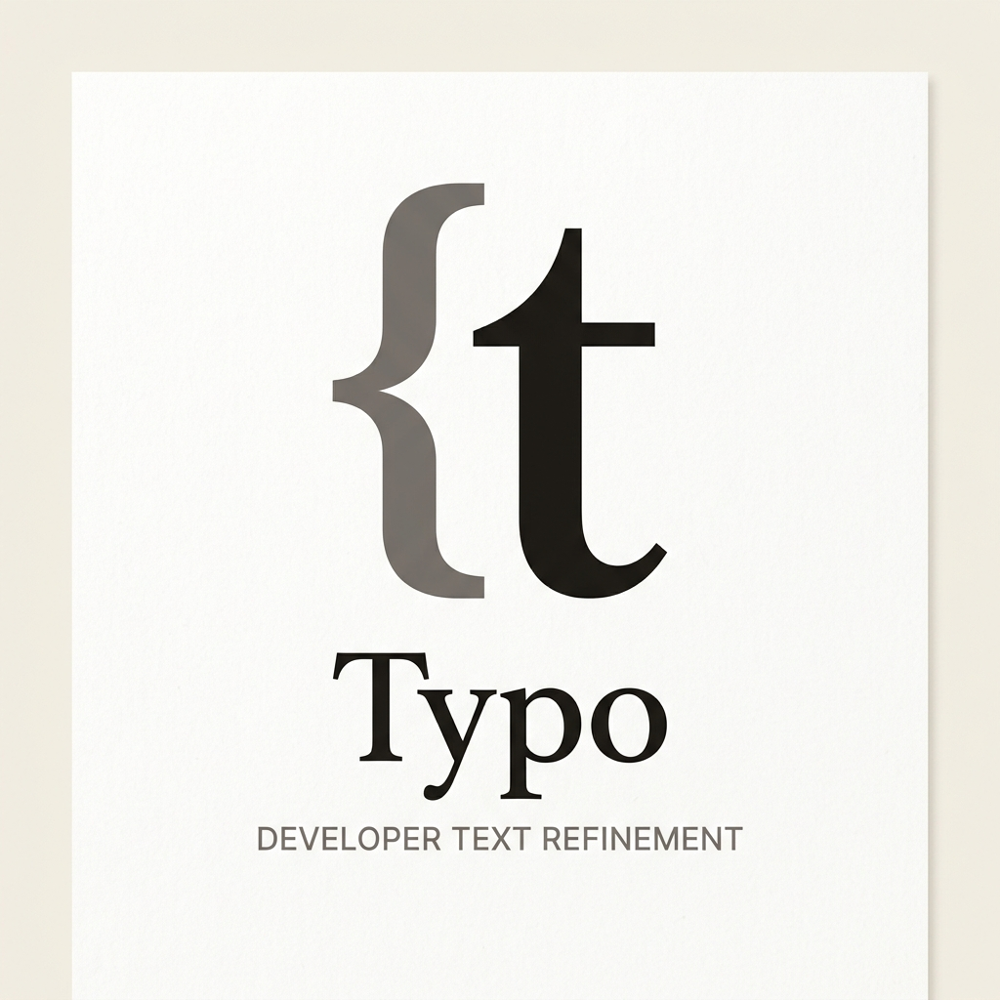
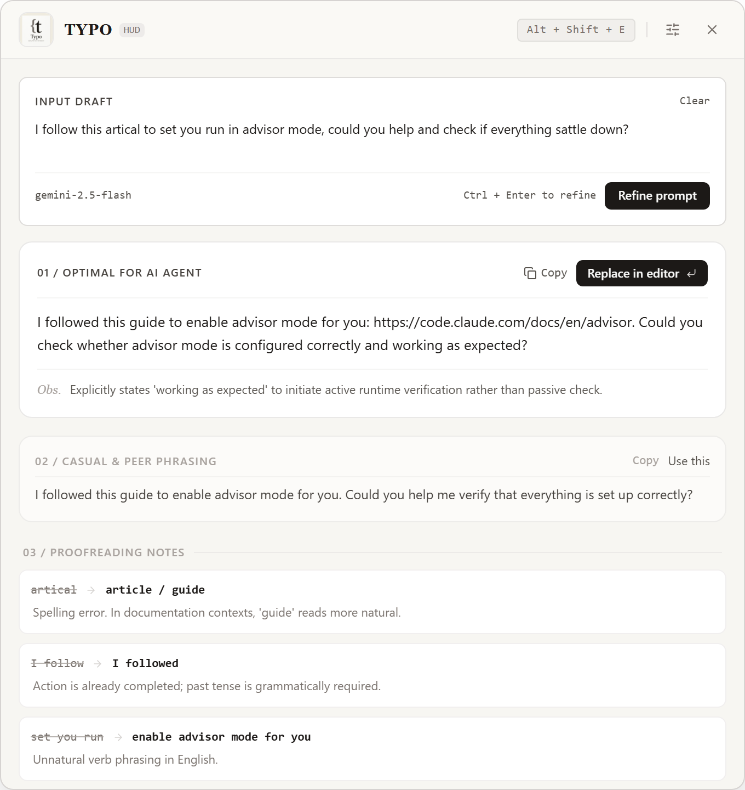
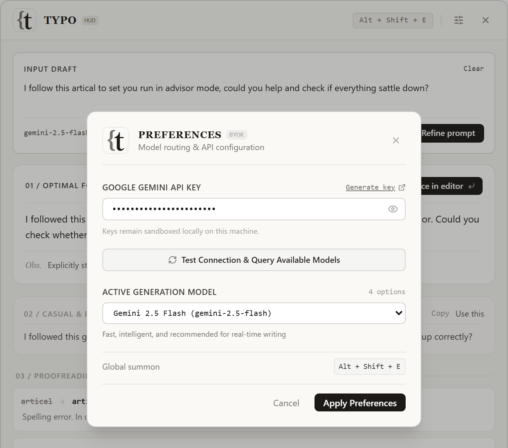

<p align="center">
  
</p>

<h1 align="center">Typo</h1>

<p align="center">
  <strong>The Editorial HUD & Prompt Architect for Developers</strong><br>
  <em>Refine rough English drafts and craft unambiguous AI prompts with quiet craftsmanship.</em>
</p>

<p align="center">
  <a href="https://github.com/alan0x/typo/releases/latest"></a>
  <a href="https://github.com/alan0x/typo/blob/main/LICENSE"></a>
  <a href="https://github.com/alan0x/typo"></a>
  <a href="https://github.com/alan0x/typo"></a>
</p>

> **Highlight text anywhere** → Trigger via `Alt + Shift + E` (Windows) or `⌥⇧E` (macOS) → Review proofreading notes & structured agent prompts → Press `Enter` to replace in-place.

---

<p align="center">
  
</p>

---

## 💡 Why Typo?

When pairing with autonomous AI coding agents like **Claude Code**, **Cursor**, or **Antigravity**, English provides the most reliable instruction following and technical context. However, non-native English speakers frequently encounter three friction points:

1. **Spelling & grammatical oversights**: Small slips like `artical` or `I follow` (when `I followed` was intended) degrade prompt quality.
2. **Ambiguous directives**: Vague wording like *"check if everything settled down"* invites superficial replies rather than thorough execution.
3. **Severe context switching**: Copying back and forth between terminal/IDE and web LLM chats fragments developer flow.

**Typo compresses this entire review cycle into a single keystroke**:
- 🔍 **Proofreading Marginalia**: Striking through errors and offering concise notes on idiomatic nuance.
- 🤖 **Faithful Polishing**: Fixes grammar, spelling, and phrasing while strictly preserving your original intent — never inventing requirements you didn't ask for.
- 💬 **Peer Phrasing**: Providing natural colloquial alternatives for Slack and GitHub reviews.
- ⚡ **Zero-Friction In-Place Replacement**: Pressing `Enter` automatically writes the refined text back to your editor and dismisses the window.

---

## 📸 Real Interface Tour

### 1. The Prompt Workshop & Editorial Breakdown
Actual capture of the desktop HUD in action:

<p align="center">
  
</p>

- **01 / Optimal For AI Agent**: Precision prompt with an editorial observation (*`Obs.`*) explaining why the phrasing elicits superior agent behavior.
- **02 / Casual & Peer Phrasing**: Clean alternatives for team communications.
- **03 / Proofreading Notes**: Side-by-side annotations showing crossed-out original text with grammatical rationale.

---

### 2. BYOK & Dynamic Model Discovery
Bring Your Own Key directly from Google AI Studio. Typo automatically queries the Google Generative AI registry to populate your active key's real model options:

<p align="center">
  
</p>

---

## ✨ Core Features

- **🎯 Cross-Platform Global Summon**: Works globally on Windows (`Alt + Shift + E`) and macOS (`⌥⇧E`).
- **⚡ Quick Replace**: `⌥⇧R` polishes and replaces in place without opening the HUD — a tiny toast shows progress. Works in GUI fields (selection or whole input box) and in terminal TUIs like Claude Code / Kimi Code, where the input box is auto-detected from the screen (strict parsing falls back to the HUD when unsure).
- **⚡ Native Text Capture**: Automatically grabs selected text upon hotkey trigger without manual `Ctrl+C`.
- **🖐️ Full Titlebar Dragging**: Smooth, native window movement anywhere across the top bar.
- **🤖 Dynamic Model Routing**: Query and switch between `gemini-2.5-flash`, `gemini-2.5-pro`, and any available generative model.
- **📓 Mistake Notebook**: Save proofreading notes to a local Markdown notebook (`~/.typo/notebook.md`, customizable) with one click — auto-categorized on save, reviewable anytime in-app, with optional AI reorganization (dedupe & regroup, always backed up first).
- **🌿 Quiet Craftsmanship**: Warm linen canvas (`#f7f6f2`), quiet typography, and zero flashy gimmicks.
- **🪶 Ultra-Low Footprint**: Powered by **Tauri 2.0 (Rust) + React 19 + Tailwind CSS**, consuming only ~30MB of RAM.

---

## ⌨️ Shortcuts Reference

| Action | Windows / Linux | macOS |
| :--- | :--- | :--- |
| **Summon Typo HUD** | `Alt + Shift + E` | `⌥⇧E` |
| **Quick Replace (no HUD)** | `Alt + Shift + R` | `⌥⇧R` |
| **Replace in Source & Dismiss** | `Enter` (when card is focused) | `Return` |
| **Refine Draft Input** | `Ctrl + Enter` | `⌘↵` |
| **Dismiss Window** | `Esc` | `Esc` |

---

## 🛠️ Tech Stack

- **Desktop Framework**: [Tauri 2.0](https://tauri.app/) (Rust backend)
- **Frontend Architecture**: React 19 + TypeScript + Vite + Tailwind CSS
- **Model Provider**: Google Gemini API via official endpoint
- **System Capabilities**:
  - `tauri-plugin-global-shortcut`: System-level key listeners
  - `tauri-plugin-clipboard-manager`: Local clipboard integration
  - `enigo` & native virtual key events: Fast selection grab & paste-back
  - System Tray integration

---

## 📦 Downloads & Installation

Pre-built binaries for **v0.1.1** are available on [**GitHub Releases**](https://github.com/alan0x/typo/releases/latest):

- **macOS (Recommended 1-Click Installer)**:
  - Apple Silicon (M1/M2/M3/M4): [`Typo_0.1.1_aarch64.pkg`](https://github.com/alan0x/typo/releases/download/v0.1.1/Typo_0.1.1_aarch64.pkg)
  - Intel: [`Typo_0.1.1_x64.pkg`](https://github.com/alan0x/typo/releases/download/v0.1.1/Typo_0.1.1_x64.pkg)
  *(Standard native macOS guided installer that configures Typo with zero terminal commands)*
- **macOS (Disk Image .dmg)**:
  - Apple Silicon: [`Typo_0.1.1_aarch64.dmg`](https://github.com/alan0x/typo/releases/download/v0.1.1/Typo_0.1.1_aarch64.dmg)
  - Intel: [`Typo_0.1.1_x64.dmg`](https://github.com/alan0x/typo/releases/download/v0.1.1/Typo_0.1.1_x64.dmg)
- **Windows**:
  - Installer: [`Typo_0.1.1_x64-setup.exe`](https://github.com/alan0x/typo/releases/download/v0.1.1/Typo_0.1.1_x64-setup.exe)
  - MSI: [`Typo_0.1.1_x64_en-US.msi`](https://github.com/alan0x/typo/releases/download/v0.1.1/Typo_0.1.1_x64_en-US.msi)

### 🍎 Note for macOS Users ("Typo is damaged and can't be opened")

Because Typo is an independent open-source project and not signed with a paid Apple Developer certificate, macOS Gatekeeper attaches a quarantine attribute to downloaded `.app` bundles, displaying:
> *"Typo is damaged and can't be opened. You should move it to the Trash."*

**The app is completely safe and undamaged.** Choose either installation path:

**Option A — .pkg installer (recommended, zero terminal commands)**
1. Download `Typo_*_aarch64.pkg` (Apple Silicon) or `Typo_*_x64.pkg` (Intel).
2. Double-click and follow the guided installer. If macOS blocks it, right-click the .pkg → **Open** → **Open Anyway**.
3. The installer automatically removes the quarantine attribute — Typo is ready to launch from Spotlight.

**Option B — .dmg disk image**
1. Open the `.dmg` and drag **Typo.app** into your **Applications** folder.
2. Open **Terminal** and run:
   ```bash
   xattr -cr /Applications/Typo.app
   ```
3. Open Typo normally from Spotlight, Launchpad, or `/Applications`.

---

## 🚀 Build from Source

### Prerequisites
- Node.js (v18+) & `pnpm`
- Rust & Cargo (1.75+)

### Installation

```bash
# Clone the repository
git clone https://github.com/alan0x/typo.git
cd typo

# Install frontend dependencies
pnpm install

# Run in development mode
pnpm tauri dev
```

### Configuration
1. Open Typo and click the **Preferences (Sliders)** icon in the header.
2. Enter your [Google Gemini API Key](https://aistudio.google.com/app/apikey).
3. Click **Test Connection & Query Available Models** to discover your available models.
4. Select your preferred model (e.g. `gemini-2.5-flash`) and click **Apply Preferences**.

---

## 🗺️ Roadmap

- [x] **Mistake Notebook**: One-click save of proofreading notes into an auto-categorized local Markdown notebook, with optional AI reorganization.
- [ ] **Flashcards**: Periodically review your most common slips (spelling, tenses).
- [ ] **TTS Pronunciation**: Listen to natural speech synthesis for verified sentences.
- [ ] **Multi-Provider Support**: Anthropic Claude, OpenAI, DeepSeek, and local Ollama.

---

## ✒️ Brand Identity: The Syntax Ligature (`{t`)

The Typo emblem marries the developer's rigid world of code syntax (`{`) with the fluid nuance of literary typography (`t`). 

Modern software engineers write two distinct languages every day: machine logic and human communication. Typo stands right at their intersection—ensuring your prompts instruct autonomous AI agents with architectural precision, and your English prose communicates with natural warmth and clarity.

---

## 📄 License

MIT License © 2026 alan0x
